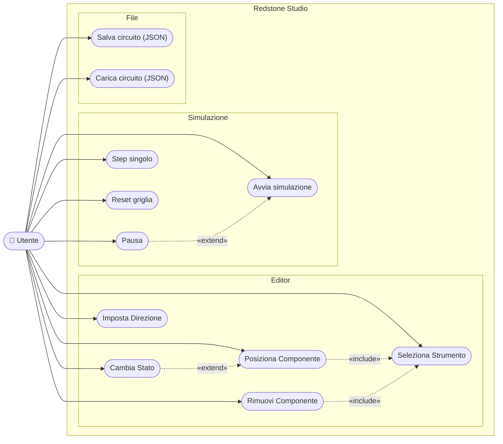

# Redstone Studio — Diagramma dei Casi d'Uso

> **Nota:** `ChangeState()` si comporta diversamente in base al componente selezionato — Lever: toggle on/off — Button: avvia impulso — Repeater: cicla il delay da 1 a 4
